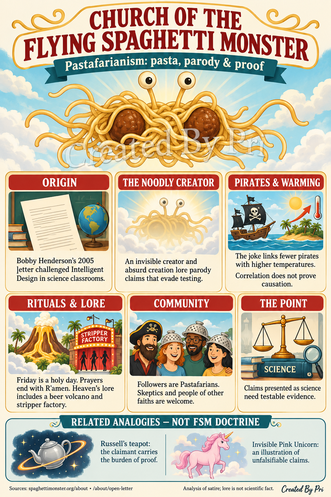
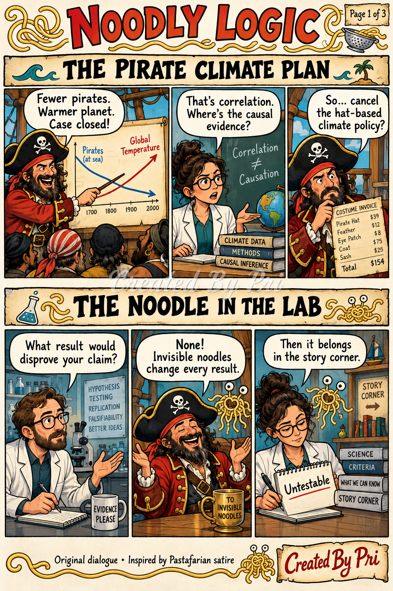
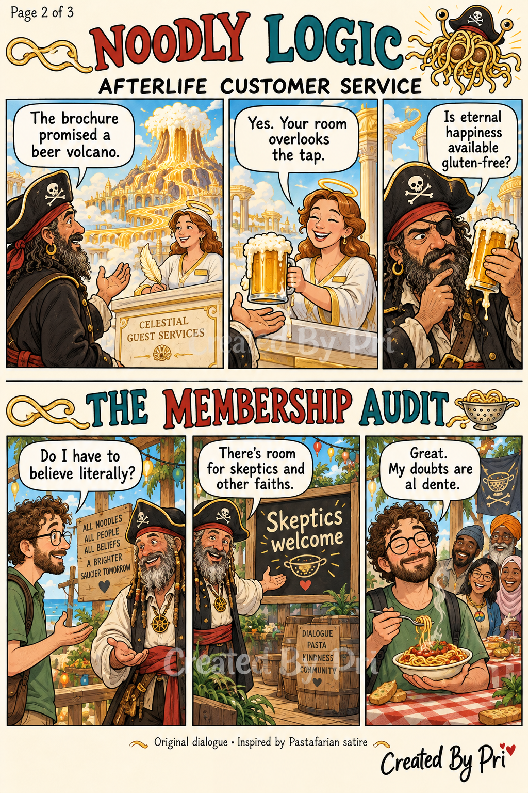
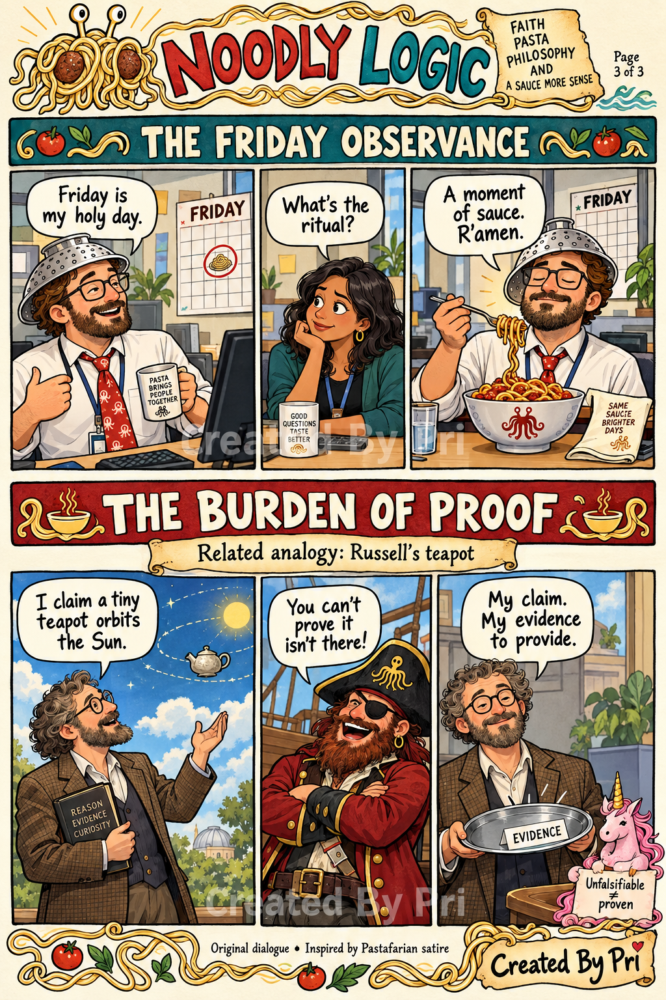

# Church of the Flying Spaghetti Monster

An illustrated analysis and six original Noodly Logic cartoon strips. All artwork carries the **Created By Pri** watermark.

Pastafarian satire challenges unsupported claims presented as science. The pirate–warming joke illustrates correlation versus causation. The Church welcomes skeptics and people of other religions. Russell’s teapot and the Invisible Pink Unicorn appear separately as related philosophical analogies.

## Infographic

## Noodly Logic

### Page 1 — The Pirate Climate Plan / The Noodle in the Lab

### Page 2 — Afterlife Customer Service / The Membership Audit

### Page 3 — The Friday Observance / The Burden of Proof

Dialogue is original, inspired by published Pastafarian satire and lore. Generated with OpenAI image generation.

## Sources

- [Church: About](https://www.spaghettimonster.org/about/)
- [Bobby Henderson’s Open Letter](https://www.spaghettimonster.org/about/open-letter/)
